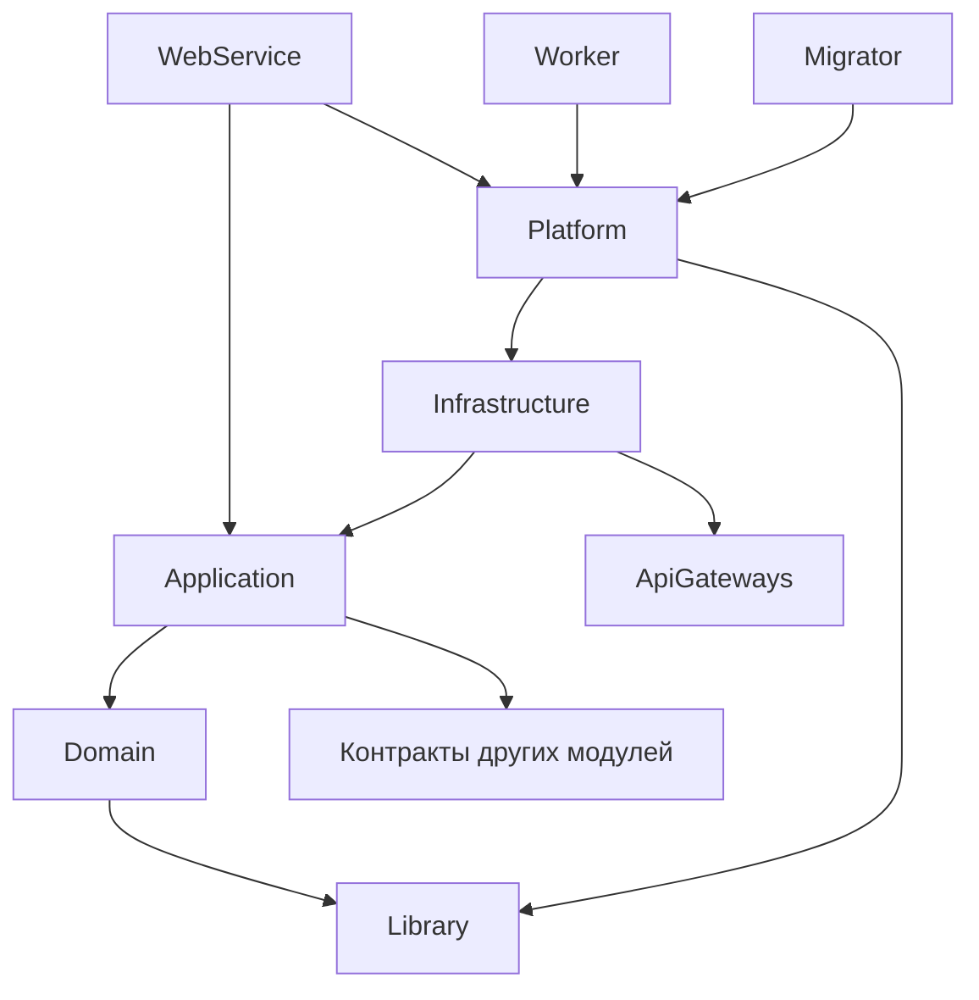

# Выбор языка и фреймворка для Backend (Core)

## Дата
14 октября 2026

## Статус
Принято (Accepted)

## Контекст
Необходимо выбрать техстек и внутреннюю структуру бэкенда системы TourBooker, который будет обрабатывать бизнес-логику бронирования, управления турами и интеграции с платежными системами. Для первоначальной версии выбран стиль модульного монолита с возможностью дальнейшего выделения модулей в отдельные сервисы.

## Ограничения
1. **Высокая конкурентность (Concurrency):** При продаже «горящих» туров система должна обрабатывать большое количество одновременных запросов на бронирование без блокировок.
2. **Строгая типизация:** Финансовые операции и работа с датами (заезды/отъезды) требуют строгой типизации для избежания рантайм-ошибок.
3. **Производительность:** Время ответа API должно соответствовать требованиям **PER01**–**PER03** в архитектурных факторах.
4. **Экосистема:** Наличие готовых библиотек для работы с PostgreSQL, Redis и платежными шлюзами.
5. **Модульность:** Модули должны иметь четкие границы и быть слабо связаны, чтобы их можно было разрабатывать независимо и при необходимости вынести в отдельный сервис.

## Решение
Использовать язык **C# 14** на платформе **.NET 10** и фреймворк **ASP.NET Core**. Приложение строится как **модульный монолит**, каждый модуль внутри организован по принципам **чистой архитектуры (Clean Architecture)**.

### Модули
| Модуль          | Ответственность                                                                                  |
| --------------- | ------------------------------------------------------------------------------------------------ |
| `Auth`          | Туристы, туроператоры, администраторы; аутентификация и роли                                     |
| `Catalog`       | Туры, поиск и фильтрация; отзывы, рейтинги, модерация                                            |
| `Booking`       | Учёт свободных мест, бронирования, временная бронь (30 минут), статусы; отчёты для туроператоров |
| `Payments`      | Платежи и возвраты, взаимодействие с платёжными провайдерами                                     |
| `Notifications` | Email-уведомления по событиям других модулей                                                     |

### Структура решения
```
src/
├── Modules/
│   ├── Booking/
│   │   ├── TourBooker.Modules.Booking.Domain
│   │   ├── TourBooker.Modules.Booking.Application
│   │   ├── TourBooker.Modules.Booking.Infrastructure
│   │   └── TourBooker.Modules.Booking.Contracts
│   ├── Catalog/
│   └── ...
├── Components/
│   ├── TourBooker.WebService
│   ├── TourBooker.Worker
│   └── TourBooker.Migrator
├── ApiGateways/
│   ├── TourBooker.ApiGateways.CloudPayments
│   └── TourBooker.ApiGateways.Email
├── Library/
│   └── TourBooker.Library
└── Platform/
    └── TourBooker.Platform
tests/
├── Modules/
│   └── <Модуль>.UnitTests, <Модуль>.Specs
└── TourBooker.ArchitectureTests
```

- **`Modules`** — бизнес-модули. Каждый модуль состоит из проектов:
  - `Domain` — агрегаты и сущности, value objects, доменные события и бизнес-инварианты. Не имеет внешних зависимостей.
  - `Application` — сценарии использования: команды и запросы (CQRS) с обработчиками, порты (интерфейсы репозиториев и внешних сервисов), DTO, валидация входных данных.
  - `Infrastructure` — реализации портов: репозитории, адаптеры к `ApiGateways`.
  - `Contracts` — публичный API модуля: интеграционные события, DTO и интерфейсы, через которые к модулю обращаются другие модули.
- **`Components`** — исполняемые проекты решения:
  - `TourBooker.WebService` — ASP.NET Core хост и HTTP API. Эндпоинты всех модулей находятся здесь (сгруппированы по модулям) и вызывают обработчики из `Application` соответствующего модуля.
  - `TourBooker.Worker` — фоновые задачи: обработчик transactional outbox, consumers RabbitMQ, снятие истёкших временных броней.
  - `TourBooker.Migrator` — применение миграций БД всех модулей.
- **`ApiGateways`** — клиенты внешних API (платёжные провайдеры, email). Вынесены отдельно для переиспользования в разных модулях и не зависят от модулей.
- **`Library`** — общая библиотека для всех проектов: базовые классы `Entity`/`AggregateRoot`/`ValueObject`, общие value objects, абстракции времени. Ни от чего не зависит.
- **`Platform`** — агрегирующая библиотека: подключает все модули и добавляет поверх общую инфраструктуру — логирование, подключение брокера сообщений (RabbitMQ), transactional outbox/inbox, распределенный кэш (Redis), аутентификацию, health checks. Исполняемые компоненты регистрируют модули и инфраструктуру только через `Platform`, а обработчики из `Application` вызывают напрямую.

### Правила зависимостей


1. Внутри модуля зависимости направлены к центру: `Infrastructure → Application → Domain`.
2. Модуль может ссылаться только на проект `Contracts` другого модуля.
3. Синхронное взаимодействие между модулями — через интерфейсы из `Contracts`, асинхронное — через интеграционные события (transactional outbox + RabbitMQ).
4. Используется одна база PostgreSQL, но каждый модуль владеет своей схемой (`booking`, `catalog`, ...). Обращения к таблицам чужого модуля и общие транзакции между модулями запрещены.
5. Модули не зависят от `Platform` и `Components`.
6. Соблюдение правил проверяется архитектурными тестами.

### Почему так
- Бизнес-логика бронирования и платежей изолирована от инфраструктуры, поэтому СУБД, кэш или платёжный провайдер можно заменить без изменения ядра.
- Четкие границы модулей позволяют в будущем вынести нагруженный модуль в отдельный сервис.
- Один деплой и одна БД на старте проще в разработке и сопровождении, чем микросервисы.

## Последствия
- **Плюсы:** Асинхронная модель и параллельная обработка пиковых нагрузок при бронировании; высокая производительность ASP.NET Core; строгая типизация; доменная логика тестируется без БД и внешних сервисов; модули разрабатываются независимо; готовый путь к микросервисам.
- **Минусы:** Больше кода и шаблонных элементов (интерфейсы портов, маппинг DTO, отдельные проекты на каждый слой); выше порог входа для новых разработчиков; взаимодействие между модулями только через контракты и события усложняет простые сценарии.
- **Риски:** Нарушение границ модулей со временем (смягчается архитектурными тестами); «анемичная» доменная модель, если логика переедет в обработчики; избыточная сложность для простых CRUD-операций; необходимость наличия в команде разработчиков, знающих C# и .NET.
